# Entity Relationship Diagram (ERD)
## AI Business Management Platform

Dokumen ini mendefinisikan skema basis data relasional PostgreSQL multi-tenant untuk mendukung fitur transaksi, peramalan (forecasting), deteksi anomali, segmentasi pelanggan, antrean persetujuan agen AI (human-in-the-loop), dan laporan berkala.

---

### 1. Diagram ERD (Mermaid)

```mermaid
erDiagram
    TENANTS ||--o{ USERS : "has"
    TENANTS ||--o{ CUSTOMERS : "manages"
    TENANTS ||--o{ PRODUCTS : "owns"
    TENANTS ||--o{ SALES_ORDERS : "records"
    TENANTS ||--o{ FINANCE_TRANSACTIONS : "tracks"
    TENANTS ||--o{ FORECASTS : "generates"
    TENANTS ||--o{ ANOMALIES : "detects"
    TENANTS ||--o{ APPROVAL_QUEUE : "reviews"
    TENANTS ||--o{ AI_REPORTS : "produces"

    CUSTOMERS ||--o{ SALES_ORDERS : "places"
    CUSTOMERS }o--|| CUSTOMER_SEGMENTS : "belongs to"

    SALES_ORDERS ||--|{ ORDER_ITEMS : "contains"
    PRODUCTS ||--o{ ORDER_ITEMS : "ordered in"
    PRODUCTS ||--o{ FORECASTS : "projected for"

    USERS ||--o{ APPROVAL_QUEUE : "requests / approves"

    TENANTS {
        uuid id PK
        varchar name
        varchar plan "starter, growth, enterprise"
        varchar status "active, suspended"
        timestamp created_at
    }

    USERS {
        uuid id PK
        uuid tenant_id FK
        varchar name
        varchar email UK
        varchar role "Owner, Admin, Analyst, Viewer"
        varchar password_hash
        timestamp created_at
    }

    CUSTOMER_SEGMENTS {
        uuid id PK
        uuid tenant_id FK
        varchar cluster_label "High-Value, At-Risk, Loyal, Hibernating"
        float rfm_score
        float silhouette_score
        text recommended_action
        timestamp updated_at
    }

    CUSTOMERS {
        uuid id PK
        uuid tenant_id FK
        uuid segment_id FK
        varchar name
        varchar email
        varchar phone
        timestamp first_purchase_at
        timestamp last_purchase_at
        decimal total_spend
    }

    PRODUCTS {
        uuid id PK
        uuid tenant_id FK
        varchar sku UK
        varchar name
        varchar category
        decimal unit_price
        decimal unit_cost
        int stock_quantity
        int reorder_point
    }

    SALES_ORDERS {
        uuid id PK
        uuid tenant_id FK
        uuid customer_id FK
        varchar order_number UK
        timestamp order_date
        decimal total_amount
        varchar status "pending, completed, cancelled"
    }

    ORDER_ITEMS {
        uuid id PK
        uuid order_id FK
        uuid product_id FK
        int quantity
        decimal unit_price
        decimal subtotal
    }

    FINANCE_TRANSACTIONS {
        uuid id PK
        uuid tenant_id FK
        varchar transaction_type "revenue, expense, refund"
        varchar category "Procurement, Payroll, Marketing, Operational"
        decimal amount
        timestamp transaction_date
        varchar reference_id
        boolean is_anomaly
    }

    FORECASTS {
        uuid id PK
        uuid tenant_id FK
        uuid product_id FK
        date forecast_date
        decimal predicted_demand
        decimal lower_bound
        decimal upper_bound
        float mape
        varchar model_name "Prophet, LSTM"
        timestamp generated_at
    }

    ANOMALIES {
        uuid id PK
        uuid tenant_id FK
        varchar entity_type "transaction, inventory, order"
        uuid entity_id
        varchar severity "LOW, MEDIUM, HIGH, CRITICAL"
        float confidence_score
        text explanation "SHAP explanation / reason"
        varchar status "OPEN, DISMISSED, RESOLVED"
        timestamp detected_at
    }

    APPROVAL_QUEUE {
        uuid id PK
        uuid tenant_id FK
        uuid requester_id FK
        varchar agent_name "CEO_Agent, Finance_Agent, Ops_Agent"
        varchar action_type "execute_payment, update_price, trigger_restock"
        jsonb payload
        varchar status "PENDING, APPROVED, REJECTED"
        uuid approver_id FK
        timestamp approved_at
        timestamp created_at
    }

    AI_REPORTS {
        uuid id PK
        uuid tenant_id FK
        varchar title
        varchar report_type "weekly_kpi, financial_summary, executive_brief"
        date start_date
        date end_date
        jsonb summary_data
        varchar pdf_storage_path
        timestamp generated_at
    }
```

---

### 2. Kamus Data Entitas Utama

1. **`tenants` & `users`**: Menjamin isolasi multi-tenant dengan *Row-Level Security (RLS)* di PostgreSQL dan pengaturan Role-Based Access Control (RBAC).
2. **`sales_orders` & `order_items`**: Menyimpan histori data transaksi penjualan per SKU yang digunakan sebagai input model peramalan deret waktu (Sales Forecasting).
3. **`customer_segments` & `customers`**: Menampung hasil klasterisasi RFM (K-Means/DBSCAN) untuk segmentasi pelanggan dan rekomendasi retensi otomatis.
4. **`forecasts`**: Menyimpan estimasi permintaan produk 30 hari ke depan lengkap dengan batas interval keyakinan (*confidence interval*) dan metrik akurasi (MAPE).
5. **`anomalies`**: Log anomali keuangan dan stok dari model *Isolation Forest* lengkap dengan nilai skor keyakinan dan bobot fitur penting (SHAP).
6. **`approval_queue`**: Antrean persetujuan aksi kritis yang diusulkan oleh agen AI (*Human-in-the-Loop*), memastikan tidak ada eksekusi finansial otomatis tanpa otorisasi pengguna.
7. **`ai_reports`**: Arsip laporan mingguan berkala otomatis berbasis LLM dalam format JSON dan berkas PDF tersimpan di MinIO.
